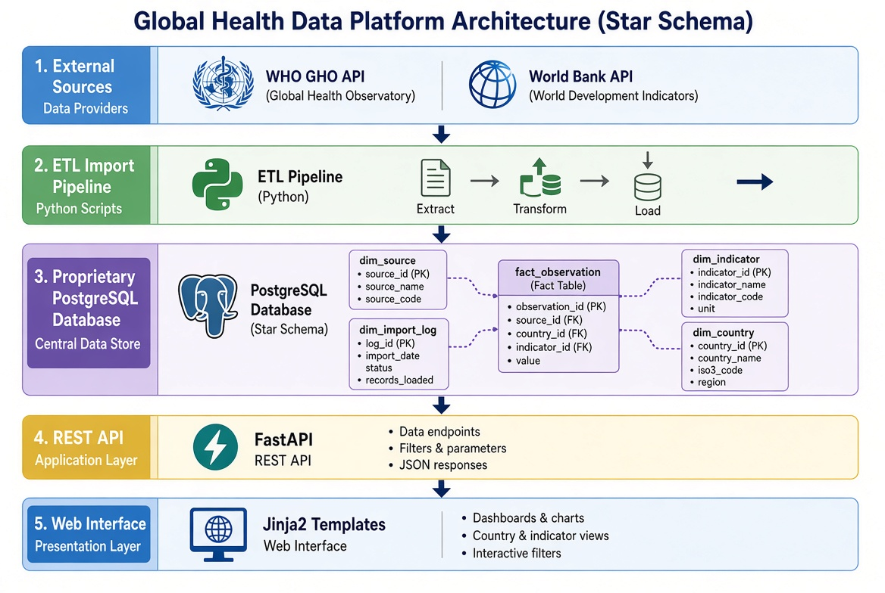
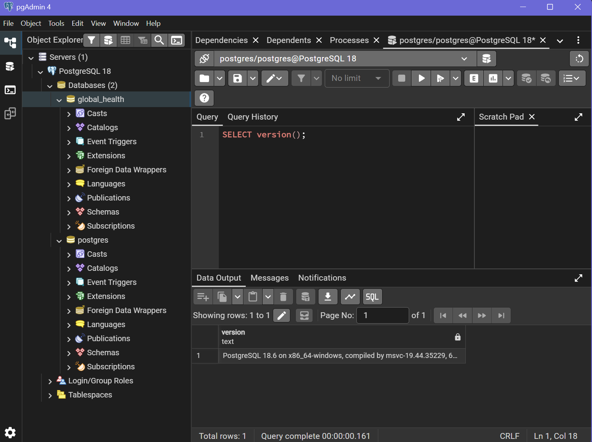
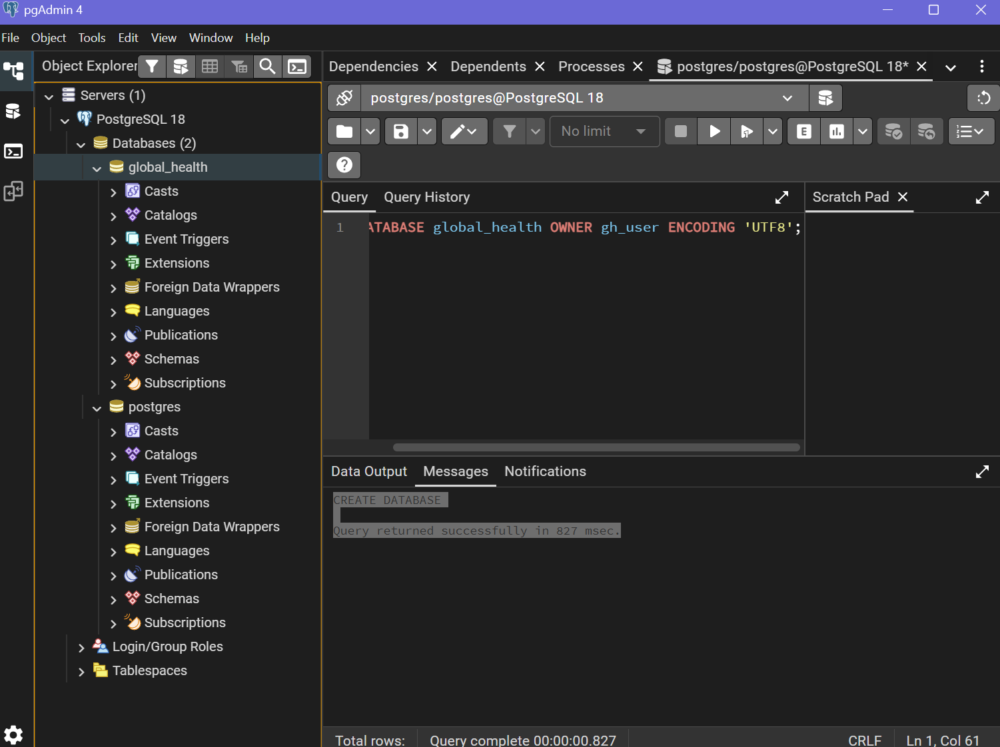

# Global Health Data Platform – Tuberculosis Burden

**Student:** Voiasciuc Vlad  
**Lab 1** – Global Health Data Platform

## Topic
Where is tuberculosis (TB) incidence falling fastest across countries, and what factors explain these differences?

## Research Question
TB remains one of the top infectious disease killers worldwide and is a key target under Sustainable Development Goal 3.3.2. This project analyzes TB incidence trends and correlates them with socioeconomic and health-system indicators.

## Data Sources
- **WHO Global Health Observatory (GHO)** – TB incidence, mortality, treatment coverage
- **World Bank Indicators** – health expenditure, GDP per capita, HIV prevalence

## Architecture



The application uses a 5-layer architecture:
1. **External Sources** – WHO GHO API and World Bank API
2. **ETL Import Pipeline** – Python scripts that extract, transform and load data
3. **Proprietary PostgreSQL Database** – Star schema (source, country, indicator, observation, import_log)
4. **REST API** – FastAPI
5. **Web Interface** – Jinja2 templates

The database is separated from external sources so that the application remains fast, reproducible and independent of external API availability.

## Screenshots

### PostgreSQL Version


### pgAdmin – global_health Database


## Project Structure
```
global-health-tb/
├── app/
│   ├── __init__.py
│   ├── database.py
│   ├── models.py
│   └── create_tables.py
├── screenshots/
│   ├── select_version.png
│   └── pgadmin_tree.png
├── .env
├── requirements.txt
├── schema_dump.sql
├── architecture_diagram.jpg
└── README.md
```

## Setup
1. Install PostgreSQL 18 and create the database:
   ```sql
   CREATE USER gh_user WITH PASSWORD 'gh_pass';
   CREATE DATABASE global_health OWNER gh_user ENCODING 'UTF8';
   ```
2. Create a virtual environment and install dependencies:
   ```bash
   python -m venv .venv
   .venv\Scripts\activate
   pip install -r requirements.txt
   ```
3. Create the tables:
   ```bash
   python -m app.create_tables
   ```

## Indicators
| Indicator | Code | Source | Unit |
|-----------|------|--------|------|
| TB incidence | MDG_0000000020 | WHO GHO | per 100 000 |
| TB mortality | TB_e_mort_exc_tbhiv_100k | WHO GHO | per 100 000 |
| TB treatment coverage | TB_c_newinc_treatment | WHO GHO | % |
| Health expenditure | SH.XPD.CHEX.GD.ZS | World Bank | % of GDP |
| GDP per capita | NY.GDP.PCAP.CD | World Bank | current US$ |
| HIV prevalence | SH.DYN.AIDS.ZS | World Bank | % of population 15-49 |
| TB treatment success | SH.TBS.CURE.ZS | World Bank | % of new cases |

## Author
Voiasciuc Vlad
