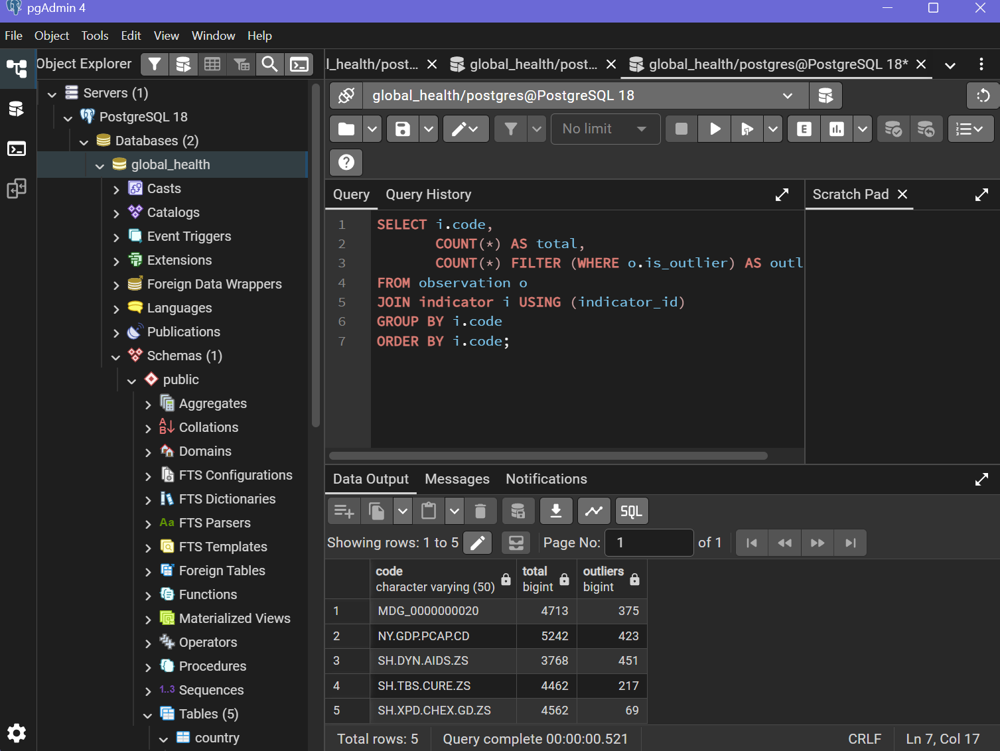
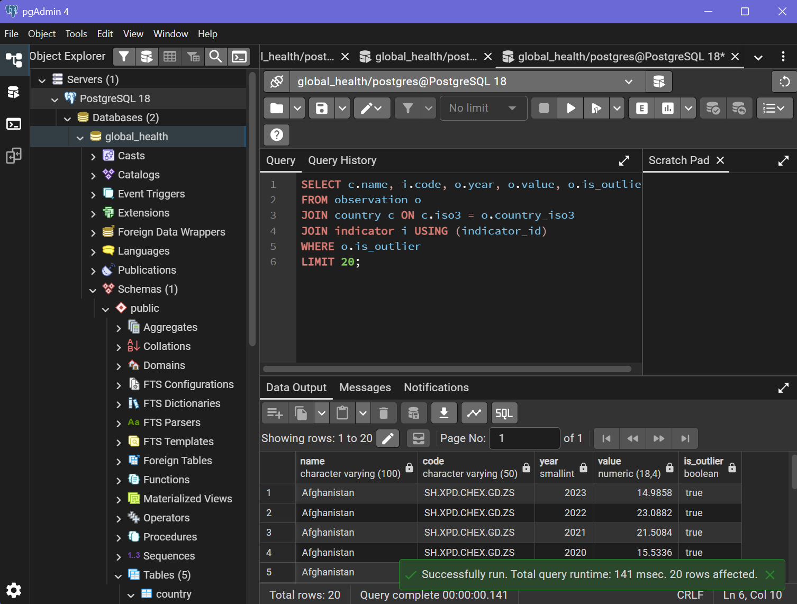
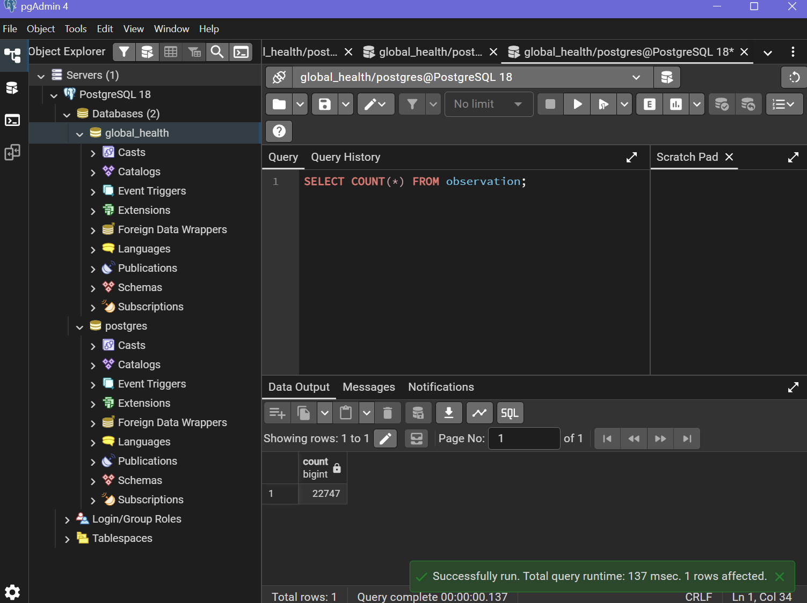

# Lab 2 – Results

## Task 2.2 – Outlier detection (IQR)

Outliers flagged with interquartile range (Q1 − 1.5×IQR to Q3 + 1.5×IQR).  
Not dropped, only marked in `is_outlier`.

| Indicator       | Total rows | Outliers |
|-----------------|------------|----------|
| MDG_0000000020  | 4713       | 375      |
| NY.GDP.PCAP.CD  | 5242       | 423      |
| SH.DYN.AIDS.ZS  | 3768       | 451      |
| SH.TBS.CURE.ZS  | 4462       | 217      |
| SH.XPD.CHEX.GD.ZS | 4562     | 69       |

### Screenshot – outliers summary

### Screenshot – sample of outlier rows

## Task 2.3 – Idempotent re-import

Re-running the import scripts does not create duplicate rows (`ON CONFLICT DO UPDATE`).

Total observations after re-import: **22747**

### Screenshot – total count

## Other screenshots
- `screenshots/pgadmin_tree.png`
- `screenshots/select_version.png`
