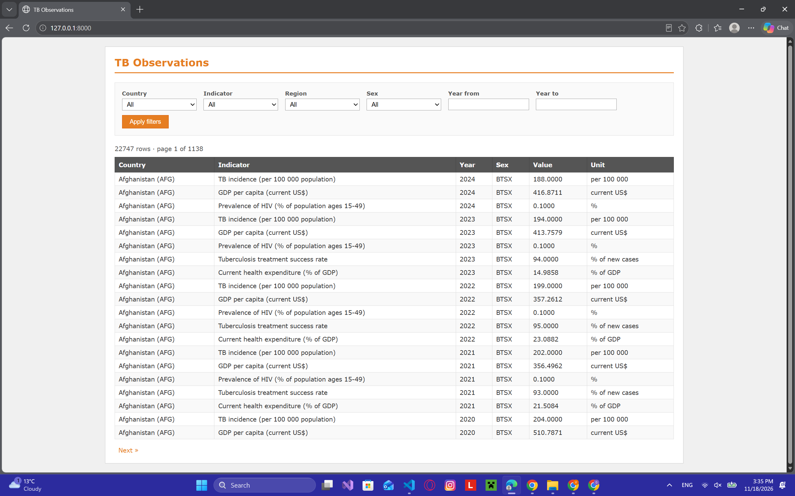
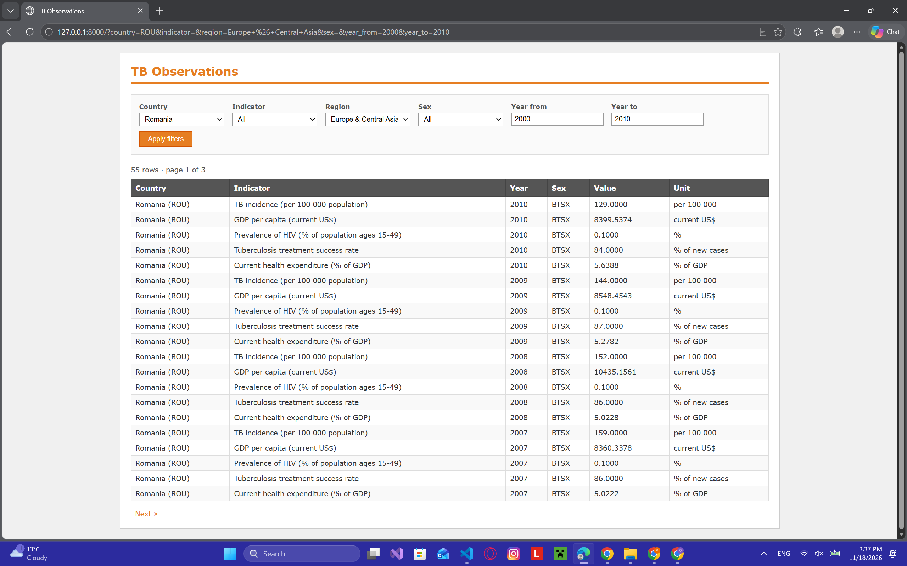

# Lab 3 – Results

## Architecture tests
- `test_architecture.py` verifies the layered structure (models, services, routes).
- All architecture tests pass.

## Service tests
- `test_observation_service.py` tests filtering and pagination logic.
- Tests cover:
  - Filtering by country, region, indicator, sex, and year range
  - Pagination
  - Correct result counts

## Application screenshots

### Main page

### Filters applied (Romania, Europe & Central Asia, 2000–2010)

## Notes
- The application correctly displays TB observations with filtering and pagination.
- Screenshots confirm the UI works as expected after applying filters.
